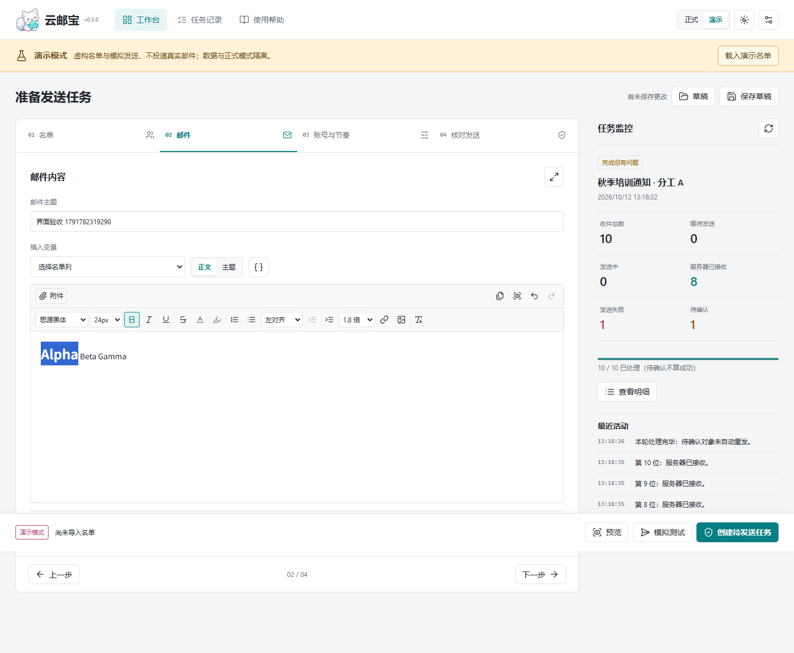
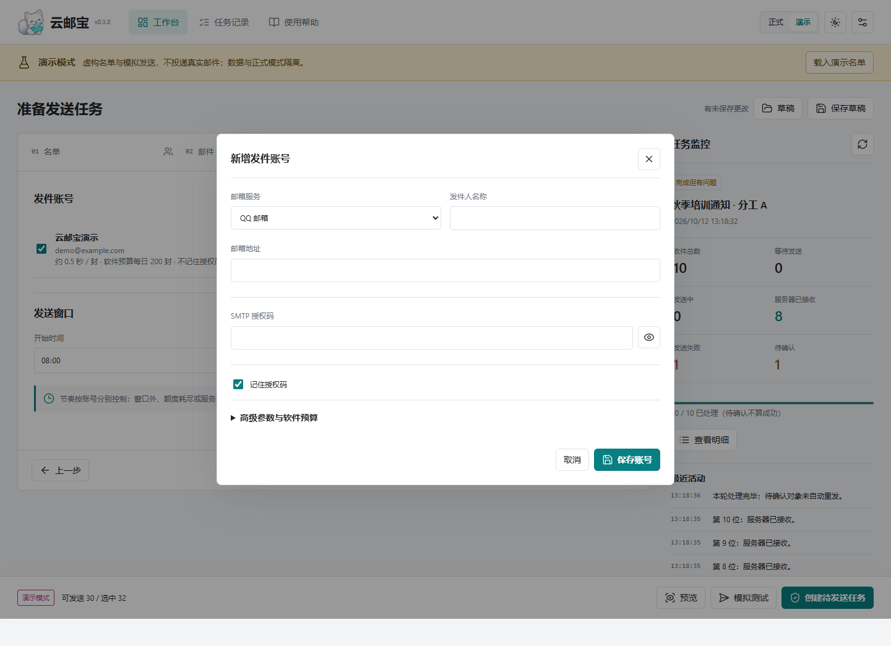
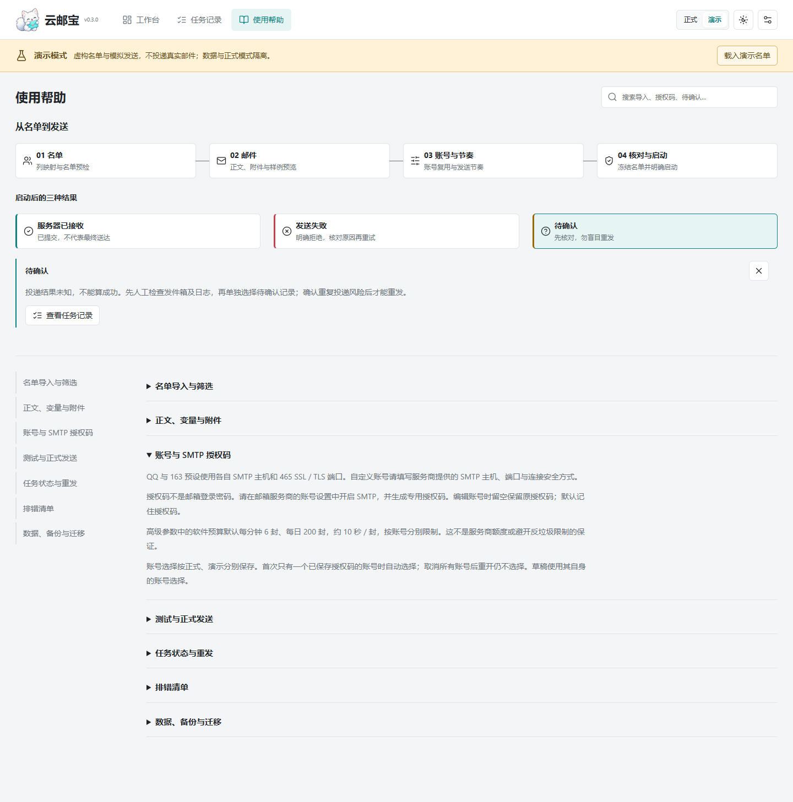

# 云邮宝 YunMailBao

面向培训、会议和活动组织者的本地名单邮件工作台。导入 Excel/CSV 名单，按表格字段筛选收件人，预览个性化邮件，再通过自己的 SMTP 邮箱发送并核对任务记录。主要使用方式是 Windows 桌面应用，不是公网群发服务。

[源码](https://github.com/OrionPace/yunmailbao) · [版本与下载](https://github.com/OrionPace/yunmailbao/releases) · [运行指南](docs/deployment-guide.md)

当前源码为 `0.3.0`，已完成本机源码回归；新版安装包尚未构建和发布。

## 能做什么

- 导入 `.xlsx` / `.csv`，选择工作表、姓名列和邮箱列；按分工等字段筛选，检查无效、重复、排除及姓名冲突。
- 使用思源黑体富文本、图片和 PDF / Word / Excel / PPT 附件，插入 `{{姓名}}` 等表头变量，保存草稿并预览。
- 冻结名单与邮件内容为任务，暂停、续发，查看失败或待确认记录并导出 Excel。
- 配置 QQ、163 或自定义 SMTP；演示模式使用虚构名单和模拟传输，不发送真实邮件。

## 如何使用

Windows 安装版需要 Microsoft Edge WebView2 Runtime。源码运行需要 Python 3.12+ 和 uv，在仓库根目录的 PowerShell 执行：

```powershell
uv sync --locked
$env:YUNYOUBAO_DATA_DIR = Join-Path $env:TEMP "YunYouBao-demo"
uv run python main.py --demo
```

不打开桌面窗口时：

```powershell
uv run python main.py --headless --demo --port 8131
```

浏览器访问 `http://127.0.0.1:8131`。`--demo` 只设置初始模式；演练请保持演示模式，不填写真实凭据。

1. 导入名单，选择列映射及筛选条件，核对问题行和可发送人数。
2. 填写主题和正文，插入变量，预览样例并检查附件。
3. 选择发件账号、发送窗口和预算，核对后创建任务。
4. 开始发送，在任务记录中处理失败与待确认结果；收到退订后更新排除名单。

正式使用时不带 `--demo`，在应用内添加账号并勾选“记住授权码”，同一 Windows 用户可重复使用已保存的授权码。账号勾选单独保存在本机，不把授权码存入浏览器。

## 界面

以下是 `0.3.0` 源码版的实际界面，使用虚构数据。





## 数据与发信边界

安装版数据位于 `%LOCALAPPDATA%\YunYouBao`，源码版默认 `.runtime\dev`，演示与正式数据分目录保存。`YUNYOUBAO_DATA_DIR` 可指定其他根目录；升级或卸载前请备份，卸载保留用户数据。Windows 保存的授权码使用当前用户 DPAPI；名单、正文和整个数据库并未加密，备份不包含保存的授权码。

仅向有合法联系依据、愿意接收相应邮件的名单发送。“服务器已接收”不等于送达或进入收件箱；结果不明时人工核对，不自动重发。商业广告选项会补充 AD 标识并保留退订联系方式，退订仍需人工更新排除名单。预算是软件设置，不是服务商额度。不要将应用端口暴露到公网或局域网。

## 许可

原创代码采用 [GPL-3.0-only](LICENSE)，第三方组件与字体遵循各自许可，见 [第三方声明](THIRD_PARTY_NOTICES.md)。原有许可未决项未解除，`0.3.0` 不因此自动公开发布。请勿提交真实授权码、名单或运行数据。
