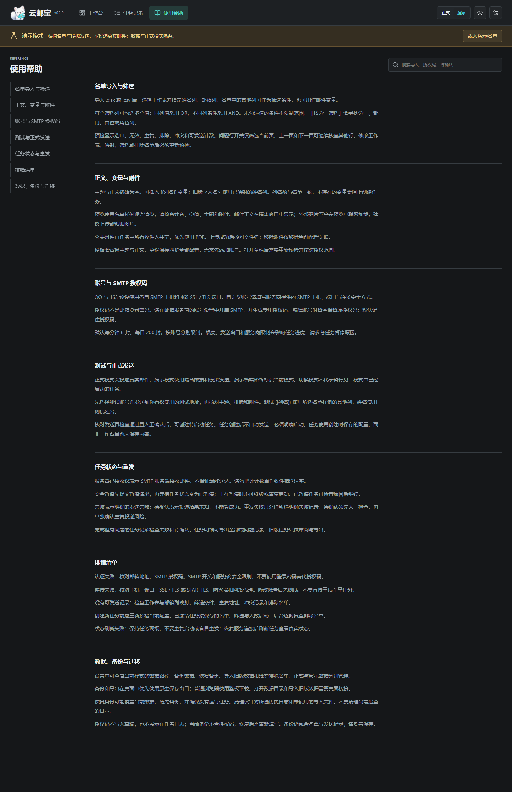
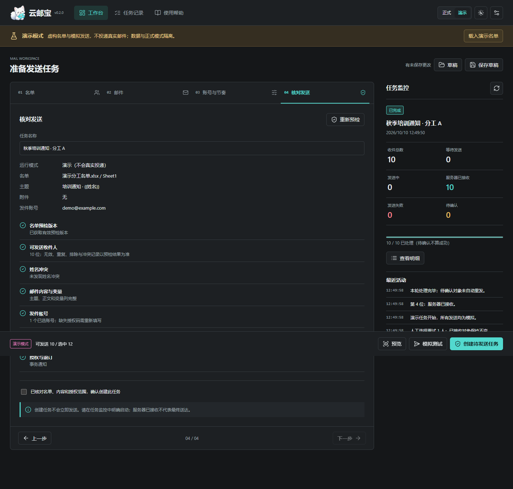

# 云邮宝 AutoEmail

白狐品牌的本地名单邮件工作台，面向培训、会议及活动通知。用自己的 SMTP 邮箱完成名单核对、个性化邮件与任务记录，主要交付形态是 **Windows 当前用户安装 EXE**，不是公网邮件营销服务。

这是一个以开源影响力和 **AI 协作工程作品**为目标的项目。AI 参与开发协作，应用本身没有内置 AI；本版不做商业访谈、付费试点或定价。当前为 `0.2.0` 候选版，已通过本机安装、覆盖升级和隔离卸载检查；**干净 Windows 环境及第三方许可未决项仍待验收，不视为正式发布**。

## 已有能力与边界

- **名单预检**：导入 `.xlsx` / `.csv`，选择工作表、姓名列和邮箱列；“分工”是通用列筛选的一种用法，多列条件取交集、同列多值取并集。显示总行数、筛选数、无效、重复、排除、姓名冲突及可发送数，不静默回退列映射。
- **冻结任务**：核对修订值后冻结有效收件人、行变量、主题、正文、账号配置和附件摘要。草稿修改不会改写历史任务；同邮箱姓名冲突阻止建任务。
- **草稿与变量**：本地 Quill 富文本、图片、PDF 附件、草稿及少量通知模板。主题和正文支持 `{{姓名}}`、`{{单位}}` 等表头变量，兼容 `<人名>`；未知或空变量阻止处理。预览与邮件构造共用渲染逻辑，MIME 含纯文本替代和 CID 图片。
- **SQLite 状态账本**：发送前落盘 `sending`，结果区分 `accepted`、`failed`、`uncertain`；启动恢复时，未完成提交转为待确认。续发只处理待发送对象，待确认不自动重发，人工重发须明确选择。单服务任务与测试发送互斥，暂停需等待工作线程退出。
- **账号与预算**：QQ/163 预设、自定义 SMTP、SSL/STARTTLS 证书校验。日预算跨任务持久保存，测试和尝试也计入；预算是软件限制，不替代服务商规则。
- **本地保护**：Windows 记住授权码使用当前用户 DPAPI，取消记住时仅存本次进程内存；账号接口不回传授权码。本地服务使用启动会话令牌及 Host/Origin 检查，上传和导出使用受控文件 ID。
- **隔离 demo 与导出**：演示使用虚构名单和模拟传输，与正式数据分目录保存。支持失败/待确认或全部记录 XLSX 导出；桌面版调用原生保存对话框，浏览器模式下载文件。备份不包含已保存授权码，恢复后需重填。

**“服务器已接收”不等于已送达、进入收件箱或已阅读。** 本项目不保证避免垃圾箱、封号或重复投递；SMTP 结果不明时保留待确认，Message-ID 仅用于追踪。退订是回复/mailto 加人工维护排除名单，不是自动一键退订。

## 先试演示

源码要求 Python 3.12+；Windows 桌面窗口需要 Microsoft Edge WebView2 Runtime。以下命令在仓库根目录的 PowerShell 执行，无需复制或读取根目录 `.env`。

```powershell
uv sync --locked
# 独立数据目录，避免接触已有正式记录
$env:YUNYOUBAO_DATA_DIR = Join-Path $env:TEMP "YunYouBao-demo"
uv run python main.py --demo
```

已有 `.venv` 时可直接运行：

```powershell
.\.venv\Scripts\python.exe main.py --demo
# 不打开桌面窗口，浏览器访问 http://127.0.0.1:8131
.\.venv\Scripts\python.exe main.py --headless --demo --port 8131
# 同一浏览器模式也可用 uv
uv run python main.py --headless --demo --port 8131
```

`--demo` 选择初始演示模式；界面仍能切换正式模式，演练请保持演示模式且勿配置真实凭据。桌面版使用动态 loopback 端口，`--port` 只用于 headless 模式。不带 `--demo` 为正式模式，请先理解发送边界。

1. 载入演示名单，选择列映射及分工等筛选，检查各项计数和问题行。
2. 填写主题、正文和变量，查看样例预览；需要复用时保存草稿。
3. 选择演示账号，核对最终人数后创建冻结任务并开始模拟。
4. 在任务记录查看模拟接收、失败、待确认，试验暂停/续发与导出。

正式发送仅用于有合法联系依据的名单；授权码在应用账号设置中输入。商业推广需填写名单来源，任务主题会补充 AD 标识，但这些机制不构成合规保证。收到退订后由操作者更新排除名单。

## 数据与部署

安装版默认数据根目录为 `%LOCALAPPDATA%\YunYouBao`；源码版为 `.runtime\dev`。`YUNYOUBAO_DATA_DIR` 可覆盖根目录，分别保存到 `live\` 和 `demo\`，每个目录含 `yunyoubao.sqlite3` 和受控文件。名单、正文、日志及备份可能含个人信息，DPAPI 只保护保存的授权码，不加密整个数据库。

旧版记录可经桌面选择目录只读导入，不修改原目录、不迁移授权码、不可直接续发。先备份并人工核对；历史暴露过的授权码仍须由持有人轮换，本轮没有代为处理。

**本版不支持公网部署。** 远程 demo 演练仅用 SSH 隧道连接 loopback，见 [运行与部署边界](docs/deployment-guide.md)。

## 测试与构建

```powershell
.\.venv\Scripts\python.exe -B -m unittest discover -s tests -v
.\.venv\Scripts\python.exe -B tests/manual_email_smoke.py
# 或
uv run python -B -m unittest discover -s tests -v
uv run python -B tests/manual_email_smoke.py
```

现有发送核心单元测试使用 SMTP 替身；手动烟测为纯 demo，创建临时数据目录、拦截 SMTP 调用，不读取 `.env`，无真实发送入口。这些测试不证明收件箱投递效果，也不替代桌面和安装器验收。

```bat
build.bat
```

构建脚本要求 uv、Python 3.12 x64，以及位于 `.tools\InnoSetup\ISCC.exe` 的 Inno Setup 7.1.0。版本从 `pyproject.toml` 的 `project.version` 读取，本轮仍为 `0.2.0` 候选。它按锁文件新建 `.build\candidate\YunYouBao\` 和 `.build\work\`，将来源和文件清单写入 `.build\candidate\build-provenance.json`；不从旧 `dist\` / `dist_release\` / `dist_candidate\` 拼包。候选内容校验后生成：

- `release\0.2.0\云邮宝-0.2.0-setup.exe`
- `release\0.2.0\build-manifest.json` 与 `release\0.2.0\SHA256SUMS.txt`

打包前，旧 `release\` 根目录顶层产物及本版本已有顶层产物分别移入 `release\0.2.0\archive\<时间>\`，不覆盖归档、不移动其他版本目录；失败重试也保留旧文件。`scripts\build_release.ps1 -PackageOnly` 只接受 `.build\candidate` 中有完整来源清单且哈希匹配的候选；旧根目录候选由维护者另行处理，不自动迁移或删除。

安装器默认按当前用户安装到 `%LOCALAPPDATA%\Programs\YunYouBao`，目录页可选择其他当前用户可写的目录，升级默认沿用上次目录；不请求管理员权限或 UAC 提权，受保护目录可能无法安装。安装目录与数据目录分离，更改安装目录不会迁移数据；缺少 WebView2 时提示官方获取途径，不自动下载；卸载保留默认及自定义用户数据。安装器提供[中文许可导读](packaging/license-zh-CN.txt)和[使用与数据知情说明](packaging/notice-zh-CN.txt)，GPL 英文原文仍为权威文本，原 `LICENSE` 不变。当前构建为未签名候选，生成文件不等于通过发布验收。候选 914 个文件、154 个 DLL/PYD 的来源及 102 份许可原文已检查；许可未决项仍列在 [第三方声明](THIRD_PARTY_NOTICES.md)。

隔离安装烟测可向 ISCC 显式传入 `InstallerAppId`（含 Inno 转义的 `{{` 和独立 GUID）、`AppName`（独立快捷方式名称）、`AppVersion`、`CandidateDir`、`ReleaseDir`，并选择独立安装目录；正式 AppId 默认保持原 GUID，避免烟测影响已有卸载注册记录和快捷方式。源码 tag 标识提交、PR 用于审查合并、GitHub Release 是线上发布页，本地 `release\<版本>\` 只是构建产物目录，生成它不等于已打 tag 或线上发布。

2026-10-10 核验记录：72 项单元／接口／安装配置测试通过；浏览器完成分工筛选、预览、模拟测试、暂停续发、失败与待确认人工重发及导出，1440、1024、390 像素窗口无页面横向溢出。实际安装后的 EXE 完成 914 个文件大小与 SHA256 核对，真实 WebView2 窗口确认编辑器初始为空、品牌图片、32 行演示名单和仅三个原生桥方法。真实安装向导的中文许可、数据说明和目录选择均已检查；本机首装、自选目录、同版本升级、隔离卸载通过。已有安装覆盖修复时，两份用户数据文件哈希未变。全部使用虚构名单或只读数据检查，没有真实发送。

浏览器验收脚本位于 `tests/browser/workflow.cjs`，依赖已锁定的 Playwright；启动隔离演示服务后执行 `npm ci --prefix tests/browser` 和 `npm --prefix tests/browser test`。Windows 原生烟测执行 `uv run python -B tests/desktop_smoke.py`。新增安装后验收命令：

```powershell
# 只浏览向导后取消，不安装
uv run python -B tests/installer_ui_smoke.py release/0.2.0/云邮宝-0.2.0-setup.exe
# 校验已安装文件并在临时数据目录启动演示，不使用真实凭据
node tests/browser/installed.cjs "$env:LOCALAPPDATA/Programs/YunYouBao/YunYouBao.exe" release/0.2.0/build-manifest.json
```

启动失败已定位并修复：原安装器的 `runtime\*` 排除规则误排了 `_internal/pythonnet/runtime/Python.Runtime.dll`，不是用户需要另装 Python；现在只排除锚定的个人数据目录，并增加完整安装文件验证。

远端 Windows/Python 3.12.10 检查还发现未闭合 script/style 内容可能吞掉退订提示；已改为独立解析退订片段，未降低测试断言。当前源码与安装候选均保留此修复，本机通过不代替跨环境 CI。

工作区已删除可再生成的旧 `build/`、`.build_candidate/`、`dist_candidate/`、根 Python 缓存、空 `logs/` / `state/` / `uploads/` 及重复烟测安装包。以后构建暂存统一位于 `.build/`，测试产物在 `tests/artifacts/`，运行数据在 `.runtime/`；这些目录和本地 `release/` 均不进 Git。历史 `dist/`、`dist_release/`、根 `.env`、本地开发环境和既有用户数据仍保留。后续补丁版本可改为 `0.2.1`；同步 `main.py` 的 `VERSION`，一致性测试会防止两者不一致。通过发布验收后再创建版本 tag 和 GitHub Release，不将重复候选当成新正式版本。

## 界面截图

以下为本版隔离演示验收生成的六张截图，不含真实名单或授权码。





## 工程依据与协作

`main.py` 负责本地 API、启动与桌面桥；`core/service.py` 负责名单预检、冻结任务、草稿和数据管理；`core/store.py` 负责 SQLite 事务与恢复；`core/engine.py` 负责任务锁、预算和执行；`core/email_sender.py` 负责渲染、MIME 与 SMTP 阶段分类。

工程上参考 listmonk 的名单分群、任务快照、抑制名单和结果分层等机制思路，不复制其 AGPL 实现，不把参考机制当作投递保证。需求与验收由项目发起人负责，AI 协助实现、审查和文档；以代码、测试及实际工件为依据，不用模型名称替代验证。当前判断与剩余验收见 [产品说明](docs/PRODUCT.md)。

## 许可证

云邮宝原创代码采用 **GPL-3.0-only**，见 [LICENSE](LICENSE)。第三方组件与素材保留各自许可和权属；公开分发前须完成随包许可核验。请勿用于垃圾邮件、钓鱼或骚扰，不提交真实授权码、名单及运行数据。
