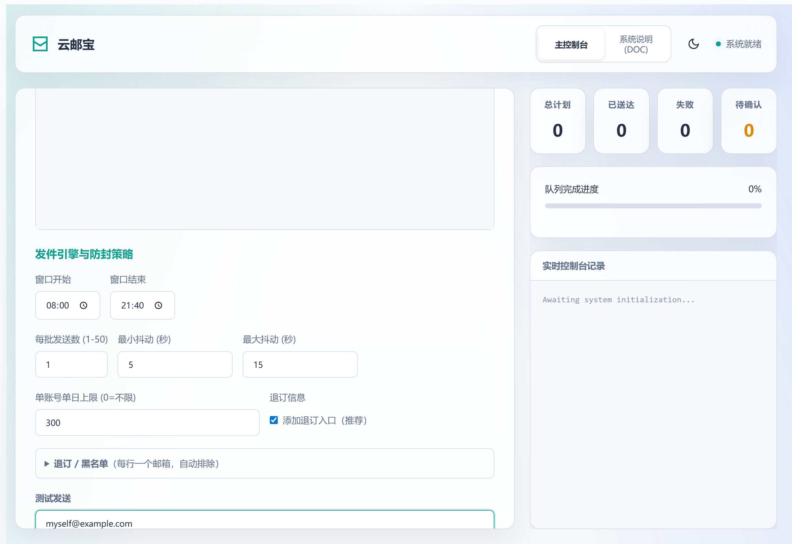
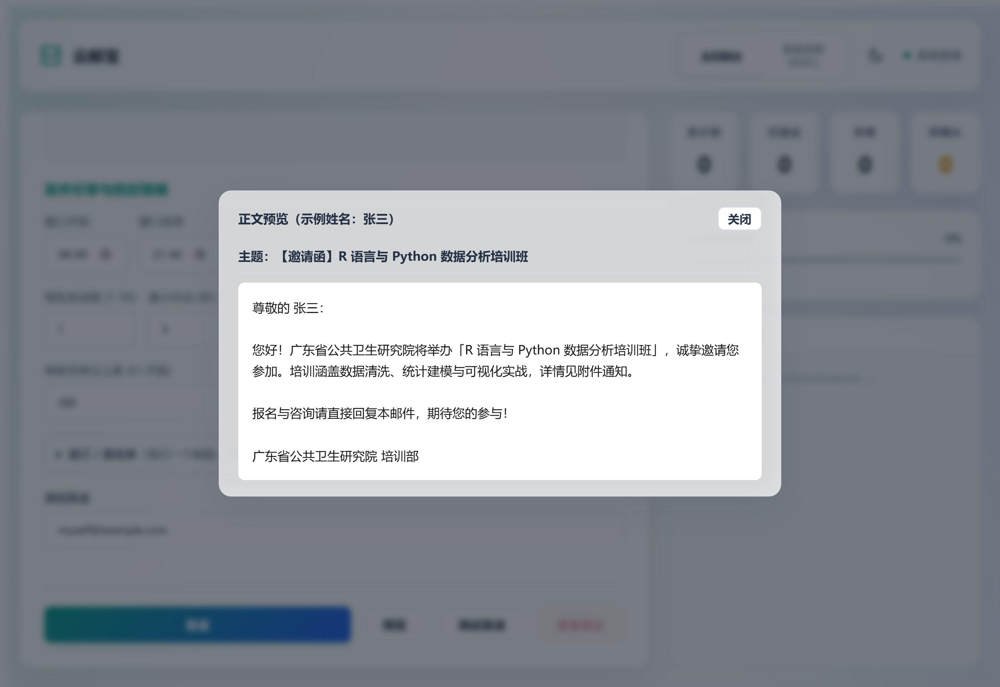
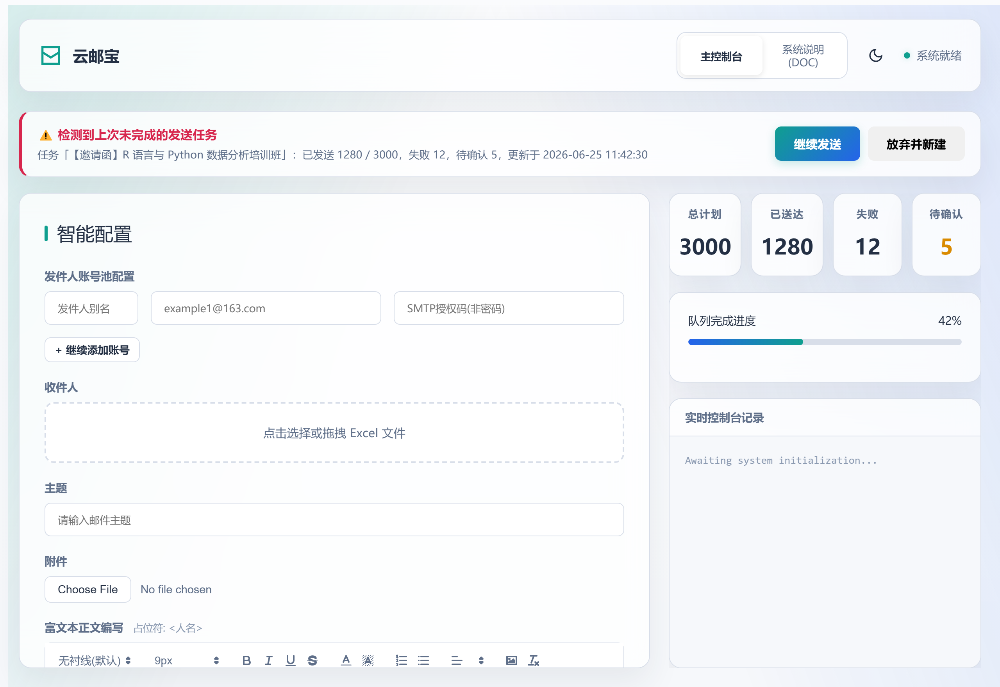
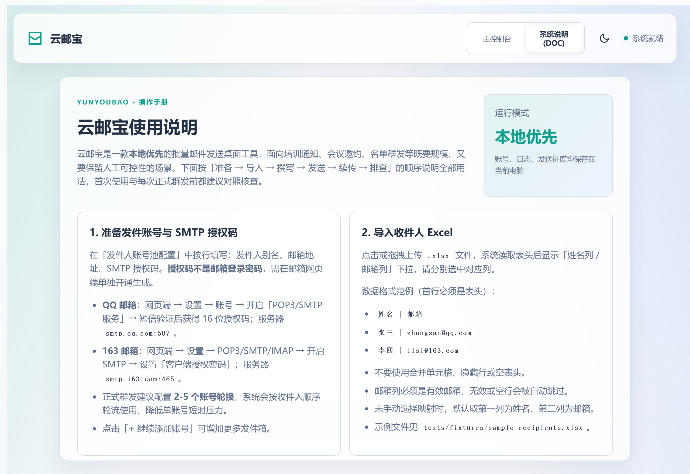

<div align="center">

# 📧 云邮宝 AutoEmail

**本地优先的批量邮件发送桌面应用 · 支持断点续传 · 防封策略 · 富文本群发**

基于 FastAPI + pywebview + Quill 构建 · Windows 一键打包为独立 EXE

</div>

---

## 这是什么

云邮宝最初为**广东省公共卫生研究院** R 语言 / Python 数据分析培训班的招生营销而生：此前需要多名研究生用各自邮箱手工向约 **3000~5000 个邮箱**发送培训通知，效率低、易被反垃圾网关拦截。云邮宝把整个流程产品化为一个桌面应用——导入 Excel 名单、富文本撰写、多账号轮换、随机防封节奏、实时监控、失败导出，并支持**断点续传**。

项目已开源，后续将交接给研究院的研究生继续维护迭代。开发与协作说明见 [AGENTS.md](AGENTS.md)。

## ✨ 功能特性

- 📥 **Excel 名单导入**：上传 `.xlsx`，可视化映射「姓名列 / 邮箱列」，自动校验并跳过无效邮箱。
- ✍️ **富文本正文 + 预览**：Quill 编辑器，支持字体/字号/行距/颜色/图片，可直接粘贴截图；`<人名>` 占位符按收件人自动替换；群发前可「预览」渲染效果。
- 🧪 **测试发送**：正式群发前先发一封到自己的邮箱，核对排版与占位符，避免大规模事故。
- 📎 **附件**：支持随邮件发送 PDF 附件。
- 🔄 **多账号轮换 + 日配额保护**：多个发件箱轮流发送，可设「单账号单日上限」，达到即自动跳过该账号、全部用尽则暂停（可续传），规避大厂日发量风控。
- 🛡️ **防封策略**：每日发送时间窗口、批次节奏、随机抖动、疲劳递增休眠，配合隐形字符盐值等手段规避反垃圾网关。
- 💾 **断点续传**：进度每发一封即落盘，断网 / 断电 / 关闭程序后重开可一键继续，**不重复发送**。
- ✅ **送达可信**：连接中断的邮件标为「待确认」（不当作成功），可一键重发，避免静默漏发。
- 📨 **退订与黑名单**：自动添加 List-Unsubscribe 退订入口，维护本地黑名单自动排除，提升送达率与合规性。
- 📊 **实时监控**：总计划 / 已送达 / 失败 / 待确认实时更新，进度条带 **ETA 预计剩余时间**、当前账号与速率；失败/待确认可导出 Excel 或一键重发。
- 🌗 **深浅双主题**：玻璃拟态 + 极光背景的现代界面。

## 🖼️ 界面预览

**主控制台** —— 左侧配置（账号 / 名单 / 正文 / 节奏 / 配额 / 退订），右侧四项指标 + 进度监控：



**正文预览** —— 群发前用示例姓名替换占位符，确认排版：



**断点续传** —— 上次任务未完成时，顶部出现提示横幅，可「继续发送」或「放弃并新建」：



**系统说明（内置手册）**：



## 🚀 快速开始（开发者）

环境要求：Python 3.12+、[uv](https://docs.astral.sh/uv/)、Windows 桌面版需 WebView2 运行环境。

```bash
# 1. 安装依赖
uv sync

# 2. 配置发件账号（复制模板后填入真实 SMTP 邮箱与授权码，切勿提交 .env）
cp .env.example .env

# 3. 启动桌面应用
uv run main.py
```

应用会在本地启动 FastAPI 服务并弹出桌面窗口。

> 仅启动 Web 服务（不弹桌面窗口，适合服务器部署）：
> `uv run uvicorn main:app --host 127.0.0.1 --port 8123`

## 📖 使用教程（6 步）

1. **配置发件账号**：在「发件人账号池配置」逐行填写别名、邮箱、SMTP 授权码（**不是登录密码**，需在邮箱网页端开通 SMTP 服务后生成）。QQ → `smtp.qq.com:587`；163 → `smtp.163.com:465`。正式群发建议配 2-5 个账号轮换。
2. **导入名单**：上传 Excel，首行为表头（如 `姓名 | 邮箱`），选择对应的姓名列与邮箱列。示例文件见 `tests/fixtures/sample_recipients.xlsx`。
3. **撰写正文**：填写主题，在富文本编辑器中编写内容；用 `<人名>` 占位符实现个性化称呼，可粘贴截图、添加 PDF 附件。可点「预览」查看渲染效果。
4. **设置节奏与配额**：设定每日发送窗口、每批发送数（新账号建议 `1`）、最小/最大抖动秒数（先 `5-15` 秒）、**单账号单日上限**（个人邮箱建议 200~300）；按需勾选「添加退订入口」、维护退订/黑名单。
5. **测试发送**：在「测试发送」填入自己的邮箱，点「测试发送」先收一封，确认排版与占位符无误——**强烈建议每次群发前必做**。
6. **发送与监控**：点击「发送」，右侧实时查看进度、ETA 与日志；结束后失败/待确认可「导出记录」或「重发失败/待确认」。需要时点「安全终止」停止（进度会保存，可续传）。

更详细的说明已内置在应用的「系统说明(DOC)」标签页中。

## 💾 断点续传说明

发送过程中，进度会在每发完一封后自动保存到运行目录的 `state/checkpoint.json`。

- 若期间**断网、断电或手动关闭**程序，重新打开云邮宝时，主控制台顶部会出现「检测到上次未完成任务」横幅。
- 点 **「继续发送」**：自动跳过已成功投递的邮箱，仅发剩余部分，不会重复发送。
- 点 **「放弃并新建」**：清除上次进度（已发出的邮件不受影响），重新发起。
- 断电场景下最多只会重发最后一封正在处理的邮件。

## 📦 Windows EXE 打包交付

```bat
build.bat
```

输出目录 `dist\云邮宝\`。交付时：

1. 将整个 `dist\云邮宝\` 文件夹复制到目标电脑；
2. 编辑其中的 `.env`，填入真实邮箱账号与授权码；
3. 双击 `云邮宝.exe` 启动。

`logs/`、`uploads/`、`state/` 会在 exe 旁自动生成，断点续传在打包版同样生效。

## 🗂️ 项目结构

```text
main.py                FastAPI 应用 + 桌面启动 + 断点续传检查点初始化
core/
  engine.py            发送队列、进度跟踪、失败分类、断点续传读写
  email_sender.py      SMTP 连接池、邮件构建、反垃圾对抗
static/                前端界面（HTML / CSS / JS + Quill）
assets/icon.ico        应用图标
docs/
  deployment-guide.md  阿里云 ECS / 域名 / Nginx / HTTPS 部署手册
  screenshots/         README 截图
tests/                 示例名单生成与手动发送烟雾测试
auto_email.spec        PyInstaller 打包配置
build.bat              Windows 一键打包脚本
AGENTS.md              开发规范与协作者说明
```

## 🤝 协作者

| 协作者 | 分工 |
| --- | --- |
| **OuYang Pace（orinpace）** | 发起人 / 产品负责人 / 需求与验收 |
| **Claude Sonnet 3.7** | 早期架构与核心引擎实现 |
| **GPT 5.5** | 反垃圾策略与功能迭代 |
| **Claude Opus 4.8** | 断点续传、文档重写与产品化 |

## ⚠️ 合规提醒

本项目仅用于正常的通知、邀约与名单邮件发送，**请勿用于垃圾邮件、钓鱼、骚扰或任何违法用途**。公网部署前务必增加登录鉴权、上传限制、CORS 白名单与操作审计（部署流程见 `docs/deployment-guide.md`）。不要将 `.env` 或真实授权码提交到 Git。
